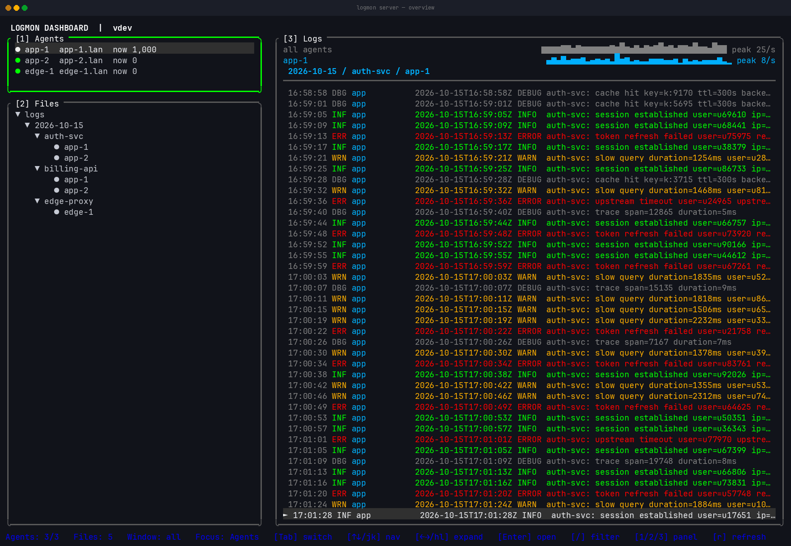
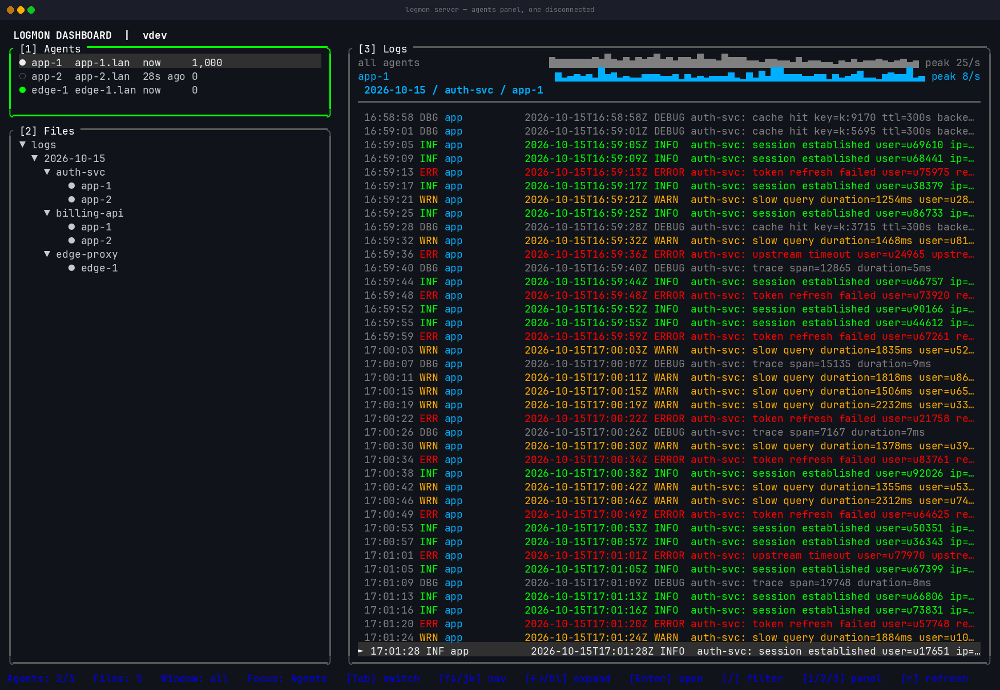
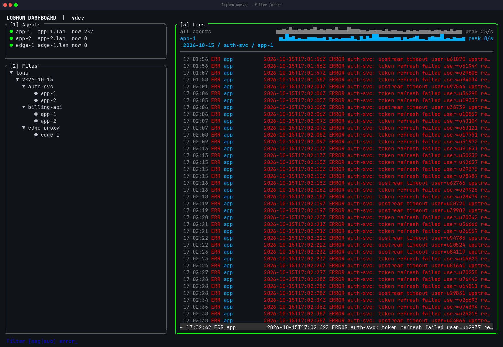
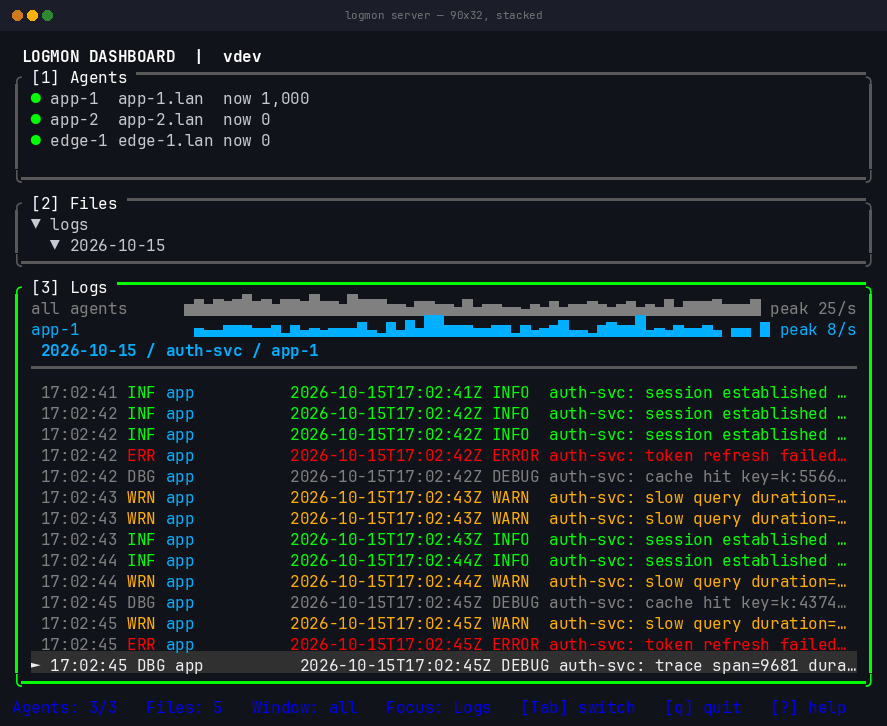
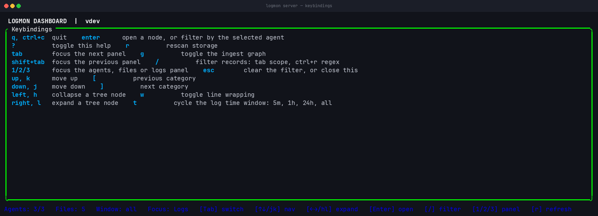

```text
██╗      ██████╗  ██████╗ ███╗   ███╗ ██████╗ ███╗   ██╗
██║     ██╔═══██╗██╔════╝ ████╗ ████║██╔═══██╗████╗  ██║
██║     ██║   ██║██║  ███╗██╔████╔██║██║   ██║██╔██╗ ██║
██║     ██║   ██║██║   ██║██║╚██╔╝██║██║   ██║██║╚██╗██║
███████╗╚██████╔╝╚██████╔╝██║ ╚═╝ ██║╚██████╔╝██║ ╚████║
╚══════╝ ╚═════╝  ╚═════╝ ╚═╝     ╚═╝ ╚═════╝ ╚═╝  ╚═══╝
```

[](https://github.com/Safouene1/support-palestine-banner/blob/master/Markdown-pages/Support.md)
[](https://github.com/Alsanea-Ala/logmon/actions/workflows/ci.yml)
[](https://github.com/Alsanea-Ala/logmon/releases/latest)
[](LICENSE)
[](go.mod)
[](https://github.com/Alsanea-Ala/logmon/releases)

# Logmon

Logmon collects Linux application logs through small agents, sends them to one
central server over raw TCP, stores them as dated JSONL files, and exposes them
in a Bubble Tea terminal UI.

> **Transport is plaintext.** Logmon has no TLS, and the agent token is sent
> in cleartext during the handshake. Run it on a trusted private LAN or inside
> a VPN, and firewall the server port to known agent addresses. Read
> [Security](SECURITY.md) before deploying anywhere else.

The current target is fewer than 50 agents on a trusted private LAN or VPN.

## Contents

- [Showcase](#showcase)
- [Features](#features)
- [Architecture](#architecture)
- [Project Structure](#project-structure)
- [Dependencies](#dependencies)
- [Install](#install)
- [Configuration](#configuration)
- [Development](#development)
- [Build](#build)
- [Production Deployment](#production-deployment)
- [Storage and TUI](#storage-and-tui)
- [Behaviour When the Server Is Unavailable](#behaviour-when-the-server-is-unavailable)
- [Troubleshooting](#troubleshooting)
- [Limitations](#limitations)
- [Documentation](#documentation)
- [Contributing](#contributing)
- [License](#license)

## Showcase



<details>
<summary>More screenshots</summary>

|  |  |
|---|---|
| **Agents panel** | **Filtering** |
|  |  |
| **The agent** | **Narrow terminals** |
|  |  |
| **Keybindings** |
|   |

</details>

Every image here is a real capture of the real binaries against a generated
dataset. The hostnames and log lines in it are synthetic.

## Features

- Collect regular files, systemd journal units, and explicit Docker containers.
- Run multiple configured sources concurrently on each agent.
- Preserve journald and Docker source timestamps when available.
- Authenticate agents against a server-side YAML allowlist.
- Keep one persistent TCP connection per agent with ACK and retry behavior.
- Stamp records on server receipt and append them to UTC-dated JSONL files.
- Show connected/seen agents and browse stored logs by date, app, agent, and
  category in a live TUI.
- Run the server headless with `--no-tui` for unattended service.
- Override YAML configuration with explicit Cobra flags.
- Reject unknown YAML fields and bound protocol frames and displayed records.

## Architecture

```text
file tail ---------\
journalctl ----------> bounded channel -> TCP sender -> Logmon server
docker logs --------/                         |              |
                                            | ACK          +-> dated JSONL
                                            +--------------+-> Bubble Tea TUI
```

Logmon uses a deliberately concrete pipeline rather than a framework of
collector interfaces: one goroutine per configured source produces records into
one bounded channel, and one sender consumes them in order. Storage is
append-only. There are no collector interfaces, factories, database
repositories, or service layers.

See [CONTRIBUTING.md](CONTRIBUTING.md) for the design constraints this project
holds to, and why.

### Runtime Flow

1. Agent loads defaults, optional YAML, environment token, and flag overrides.
2. Agent validates identity and sources, then starts one goroutine per source.
3. Agent connects and sends a `Hello` frame containing protocol version,
   identity, token, and declared apps.
4. Server hashes the supplied token and compares it with the configured
   allowlist entry.
5. Agent sends one NDJSON `Record` and waits for an `Ack`.
6. Server validates the record, adds trusted connection identity and UTC
   receipt time, then appends it.
7. Server ACKs only after the append succeeds and sends the stored record to the
   TUI.
8. A failed connection retains the current record in memory and reconnects after
   `retry_delay`.

## Project Structure

```text
cmd/
  agent/main.go             Cobra agent command and flag precedence
  server/main.go            Cobra server command and flag precedence
internal/
  agent/
    config.go               Agent YAML, source CSV parsing, validation
    agent.go                Source collection, cursors, TCP sender
  protocol/
    message.go              Bounded NDJSON wire and stored record types
  server/
    server.go               Allowlist auth, registry, TCP ingest, storage
    tui.go                  Bubble Tea model, storage scan, navigation
examples/                   Tracked config templates; real configs are ignored
```

Tests live beside their packages. Runtime binaries and data are written to
`bin/` and `data/`, both ignored by Git, as are `agent.yaml` and `server.yaml`.
Only the `examples/` templates are tracked, so a clean clone has something to
copy from.

## Dependencies

### Runtime Libraries

| Library | Purpose |
|---|---|
| [`github.com/charmbracelet/bubbletea`](https://github.com/charmbracelet/bubbletea) | Server terminal UI |
| [`github.com/nxadm/tail`](https://github.com/nxadm/tail) | Follow regular files and rotation |
| [`github.com/spf13/cobra`](https://github.com/spf13/cobra) | Agent and server flags/help |
| [`gopkg.in/yaml.v3`](https://pkg.go.dev/gopkg.in/yaml.v3) | Strict YAML configuration decoding |

TCP, JSON, process execution, hashing, signals, concurrency, and rooted
filesystem access use the Go standard library. All direct dependencies are MIT,
BSD, or Apache-2.0 licensed, which is compatible with this project's AGPLv3
license. Exact versions are pinned by `go.mod` and `go.sum`.

### Host Tools

| Tool | Required when |
|---|---|
| Go `1.25.7` | Building or developing |
| `journalctl` | A journald source is configured |
| Docker CLI | A Docker source is configured |
| `golangci-lint` | Running `make lint` or pre-commit hooks |
| Lefthook | Installing/running repository pre-commit hooks |
| OpenSSL or another secure generator | Creating agent tokens |

## Install

Requires Go `1.25.7` or later on Linux.

```bash
go install github.com/Alsanea-Ala/logmon/cmd/server@latest
go install github.com/Alsanea-Ala/logmon/cmd/agent@latest
```

Both binaries land in `$GOBIN`, or `$GOPATH/bin` if `GOBIN` is unset. Confirm
with `go env GOBIN`.

> **No tagged release exists yet.** `@latest` resolves to the newest semver tag,
> and this project has not published one. Until `v0.1.0` is tagged, install
> from the default branch instead:
>
> ```bash
> go install github.com/Alsanea-Ala/logmon/cmd/server@main
> go install github.com/Alsanea-Ala/logmon/cmd/agent@main
> ```
>
> That works but is not reproducible. If you deploy Logmon, build from a pinned
> commit or wait for a tag.

There is no package repository, container image, or prebuilt release binary
yet. To build from source instead, see [Build](#build).

## Configuration

Unknown YAML keys fail startup. Agent IDs and app names accept letters,
numbers, `.`, `_`, and `-`; tokens must contain at least 32 characters.

`hostname` is required and has no default. Logmon does not fall back to
`os.Hostname()`, because the value is stored with every record and a silently
inferred one can differ from the name you use everywhere else. Set it in YAML
or pass `--hostname`.

Ready-to-copy templates are in [`examples/`](examples/):

```bash
cp examples/server.example.yaml server.yaml
cp examples/agent.example.yaml  agent.yaml
```

### Authentication Token

Generate a high-entropy token and its server-side SHA-256 digest:

```bash
TOKEN="$(openssl rand -hex 32)"
echo "TOKEN: $TOKEN"
echo "SHA256: $(printf '%s' "$TOKEN" | sha256sum | cut -d' ' -f1)"
```

> **Use `printf '%s'`, not `echo`.** `echo` appends a trailing newline before
> hashing, producing a completely different digest. This is the most common
> setup failure, and it presents as an agent that silently refuses to connect.

Put the 64-character hash in `server.yaml`. Put the original token in protected
agent YAML or `LOGMON_AGENT_TOKEN`. The environment variable is used only when
YAML does not contain `token`.

Do not pass secrets as command-line flags; command lines may be visible to other
users.

### Server YAML

```yaml
listen: <server-ip>:<port>
data_dir: /var/lib/logmon
max_connections: 100
agents:
  prod-1:
    token_sha256: "<64-character-sha256>"
  prod-2:
    token_sha256: "<64-character-sha256>"
```

| Field | Required | Default | Meaning |
|---|---|---|---|
| `listen` | No | `127.0.0.1:9000` | TCP bind address |
| `data_dir` | No | `data` | JSONL storage root |
| `max_connections` | No | `100` | Maximum simultaneous accepted connections |
| `agents` | Yes | None | Allowed agent IDs and token hashes |

Relative `data_dir` values resolve from the server config file directory. The
server is not useful without an allowlist, so production runs should always pass
`--config`.

### Agent YAML

```yaml
id: prod-1
hostname: api-01
server: <server-ip>:<port>
token: "<original-random-token>"
retry: true
retry_delay: 2s
sources:
  - type: file
    path: /var/log/nginx/access.log
    app: nginx
    category: access
    from_beginning: false

  - type: journald
    unit: billing.service
    app: billing
    category: service
    from_beginning: false

  - type: docker
    container: billing-api
    app: billing
    category: container
    from_beginning: false
```

| Field | Required | Default | Meaning |
|---|---|---|---|
| `id` | Yes | None | Stable allowlisted agent ID |
| `hostname` | Yes | None | Host label stored with records, 1-255 characters |
| `server` | No | `127.0.0.1:9000` | Server TCP address |
| `token` | Yes unless environment is set | `LOGMON_AGENT_TOKEN` | Authentication secret |
| `retry` | No | `true` | Restart failed sources and reconnect TCP |
| `retry_delay` | No | `2s` | Delay between attempts |
| `sources` | Yes | None | One or more source definitions |

Relative file paths resolve from the agent config file directory. CLI file paths
resolve from the process working directory.

### Source Fields

| Type | Required target | Collector | `from_beginning: false` |
|---|---|---|---|
| `file` | `path` | `github.com/nxadm/tail` | Seek to current file end |
| `journald` | `unit` | `journalctl --follow --output=json` | Start with `--lines=0` |
| `docker` | `container` | `docker logs --follow --timestamps` | Start with `--tail=0` |

Every source also requires `app` and `category`. `from_beginning` defaults to
`false`.

Cursors are per-source and live only in memory. They differ in precision:

- **journald** resumes from an exact journal cursor (`--after-cursor`), so a
  reconnect does not re-read entries.
- **docker** resumes from the timestamp of the last line seen (`--since`), which
  is coarse. A reconnect can re-emit the tail of the log.
- **file** resumes from a byte offset, and infers rotation from inode change or a
  shrinking file. `rename` then create and `copytruncate` can each produce a gap
  or a duplicate block.

None of these cursors survive an agent restart.

### Flags and Precedence

Show all flags:

```bash
go run ./cmd/agent  --help
go run ./cmd/server --help
```

Agent source flags are repeatable CSV records. Any `--file`, `--journal`, or
`--docker` flag replaces the entire YAML source list:

```bash
LOGMON_AGENT_TOKEN="$TOKEN" go run ./cmd/agent \
  --id prod-1 \
  --server 10.0.0.5:9000 \
  --file '/var/log/nginx/access.log,nginx,access,false' \
  --journal 'billing.service,billing,service,false' \
  --docker 'billing-api,billing,container,false'
```

In fish, export the token first — note the `set -x` difference:

```fish
set -x LOGMON_AGENT_TOKEN "$TOKEN"
go run ./cmd/agent \
  --id prod-1 \
  --server 10.0.0.5:9000 \
  --file '/var/log/nginx/access.log,nginx,access,false' \
  --journal 'billing.service,billing,service,false' \
  --docker 'billing-api,billing,container,false'
```

Other flags override only their corresponding YAML field. Server allowlist
entries have no CLI flag.

## Development

### Prerequisites

- Go `1.25.7`, matching `go.mod`
- `golangci-lint` on `PATH` for linting
- `journalctl` and Docker only when manually exercising those collectors

Bare `make` prints available commands and does not install or modify tools.

### Run Locally

Copy the example configs and fill in a real token digest:

```bash
cp examples/server.example.yaml server.yaml
cp examples/agent.example.yaml  agent.yaml

TOKEN="$(openssl rand -hex 32)"
HASH="$(printf '%s' "$TOKEN" | sha256sum | cut -d' ' -f1)"

sed -i "s|<64-character-sha256-hex-digest>|$HASH|" server.yaml
```

Start the server in one terminal:

```bash
go run ./cmd/server --config server.yaml
```

Start an agent in another terminal:

```bash
export LOGMON_AGENT_TOKEN="$TOKEN"
go run ./cmd/agent --config agent.yaml
```

For a file source with `from_beginning: false`, start the agent first and
append a line afterward:

```bash
printf '%s\n' 'test log record' >> app.log
```

The record should appear in the TUI within a second or two. In fish, use
`set -x LOGMON_AGENT_TOKEN "$TOKEN"` in place of `export`.

### Verify

```bash
make fmt
make vet
make lint
go test ./...
go test -race ./...
make build
```

Run one package or test:

```bash
go test ./internal/server
go test ./internal/server -run '^TestAuthenticatedRecordIsStoredBeforeAck$'
```

Lefthook runs formatting, vet, lint, and tests serially. Formatting may modify
and stage files.

## Build

Build both host-platform binaries:

```bash
make build
```

Outputs:

```text
bin/agent
bin/server
```

Build Linux release binaries explicitly:

```bash
CGO_ENABLED=0 GOOS=linux GOARCH=amd64 go build -trimpath -o bin/logmon-agent ./cmd/agent
CGO_ENABLED=0 GOOS=linux GOARCH=amd64 go build -trimpath -o bin/logmon-server ./cmd/server
sha256sum bin/logmon-agent bin/logmon-server
```

Change `GOARCH` to `arm64` for 64-bit ARM Linux. The repository has no release
automation, package builder, container image, or generated artifacts.

## Production Deployment

1. Build for the target Linux architecture and copy `logmon-agent` to each
   source host and `logmon-server` to the central host.
2. Install binaries under `/usr/local/bin/` and configs under `/etc/logmon/`.
3. Store server data under `/var/lib/logmon/` and set `data_dir` accordingly.
4. Protect agent config/environment files with mode `0600` and use a distinct
   token per agent.
5. Bind the server to its VPN/private address and firewall the port to agent
   addresses only.
6. Run agents as a dedicated `logmon` user with only source-specific read
   permissions.
7. Monitor free disk space and manage retention externally; Logmon never deletes
   stored files.

Because Logmon never deletes anything, retention is entirely your responsibility.
Logmon is happy as long as this runs on a timer:

```bash
# Delete stored records older than 30 days.
find /var/lib/logmon -name '*.jsonl' -mtime +30 -delete
find /var/lib/logmon -type d -empty -delete
```

Run it from a systemd timer. Deleting a file the TUI has open is safe; the
records simply stop being rescanable.

### Agent systemd Service

`/etc/systemd/system/logmon-agent.service`:

```ini
[Unit]
Description=Logmon agent
Wants=network-online.target
After=network-online.target

[Service]
User=logmon
SupplementaryGroups=systemd-journal docker
EnvironmentFile=/etc/logmon/agent.env
ExecStart=/usr/local/bin/logmon-agent --config /etc/logmon/agent.yaml
Restart=always
RestartSec=2
NoNewPrivileges=true

[Install]
WantedBy=multi-user.target
```

`/etc/logmon/agent.env`:

```bash
LOGMON_AGENT_TOKEN=<original-random-token>
```

Use `systemd-journal` or distribution-specific `adm` membership for journal
access. Add `docker` only when Docker sources are configured: Docker
socket/group access is effectively root. Prefer Docker's journald logging driver
when possible, then remove `docker` from `SupplementaryGroups`.

Journal group membership varies by distribution:

| Distribution | Group granting journal read access |
|---|---|
| Debian, Ubuntu | `systemd-journal` or `adm` |
| Fedora, RHEL, CentOS Stream | `systemd-journal` |
| Arch Linux | `systemd-journal` |
| openSUSE | `systemd-journal` |

Verify on your own hosts rather than trusting the table blindly; some
distributions ship `systemd-journal` read-only and unprivileged access works
without any group membership at all.

Enable the agent:

```sh
sudo systemctl daemon-reload
sudo systemctl enable --now logmon-agent
sudo systemctl status logmon-agent
```

### Server Process

Use `--no-tui` to run the server without the terminal UI. This is required for
an unattended service — without it the server starts a Bubble Tea program that
needs a terminal and will not run correctly under systemd.

`/etc/systemd/system/logmon-server.service`:

```ini
[Unit]
Description=Logmon server
Wants=network-online.target
After=network-online.target

[Service]
User=logmon
ExecStart=/usr/local/bin/logmon-server --config /etc/logmon/server.yaml --no-tui
Restart=always
RestartSec=2
NoNewPrivileges=true

[Install]
WantedBy=multi-user.target
```

The server must be able to write `data_dir` and read its config. Grant the
`logmon` user ownership of `/var/lib/logmon`.

To watch logs live, either run the server in a terminal instead, or read the
JSONL files directly — there is no remote or HTTP viewer. See
[Storage and TUI](#storage-and-tui).

The sections above cover installing it. For upgrades, failure behaviour,
capacity and the constraints that fail loudly, see
[docs/user/deployment.md](docs/user/deployment.md).

## Storage and TUI

The server stamps accepted records in UTC and stores them under:

```text
/var/lib/logmon/YYYY-MM-DD/<app>/<agent-id>.jsonl
```

Each line contains receipt time, optional source time, authenticated agent ID
and hostname, source type, app, category, and raw log text.

The TUI is a terminal program running on the server host. It is the only viewer;
there is no web interface and no way to attach from another machine.

| Key | Action |
|---|---|
| `Tab` / `shift+tab` | Focus the next or previous panel |
| `1`, `2`, `3` | Focus the agents, files or logs panel |
| `↑` / `↓` or `k` / `j` | Select log line |
| `←` / `→` or `h` / `l` | Expand or collapse the date/app/agent tree |
| `[` / `]` | Select category |
| `Enter` | Open the selected node, or filter the logs to the selected agent |
| `/` | Filter loaded records. In the prompt, `tab` switches scope and `ctrl+r` switches to a regular expression |
| `esc` | Clear the filter |
| `w` | Show or hide line wrapping |
| `g` | Show or hide the ingest graph |
| `t` | Cycle the log time window: 5m, 1h, 24h, all. The default is all |
| `r` | Rescan storage |
| `?` | Keybindings |
| `q`, `ctrl+c` | Quit the server |

The TUI keeps at most the latest 1,000 records from the selected file in memory.
It receives newly appended records live and rescans the storage tree only on
startup or `r`.

`/` filters only those loaded records. It is not a search across stored data,
and there is no pagination.

## Appearance

The TUI reads an optional config file, by default
`~/.config/logmon/config.yml`. Point `--gui-config` elsewhere, or pass an empty
value to switch it off.

```yaml
gui:
  border: rounded          # rounded | single | double | hidden
  sidePanelWidth: 0.333    # share of the terminal width, clamped to 0.2-0.6
  graph: true              # ingest graph on by default
  wrap: false              # wrap long log lines on by default
  mouse: false             # click and wheel support, off by default
  theme:
    borderActive: green
    borderInactive: white
    selectedBg: blue
    accent: brightblue
    err: red
```

Every field is optional and keeps its default when omitted, so a file setting
only a border is valid.

Colours accept a name (`red`, `brightgreen`, …), a 256-colour index (`46`), or
`#rrggbb`. The numeric form exists because the built-in palette is expressed as
indices and the config should not be a downgrade.

Parsing is strict: an unknown key or an unknown colour or border name is
rejected, and the server starts on defaults with a visible `GUI config` line in
the log panel. A silently ignored typo is the failure that costs an afternoon.

### Colours used as backgrounds must be 16-255

Indices 0-15 are the sixteen ANSI colours, and your terminal is free to remap all
of them. Indices 16-255 are fixed RGB in the xterm palette and render the same
everywhere.

For a foreground this does not matter much: a border that comes out a different
green than you expected still reads as a border. For a background it matters a
lot, because the text sitting on top of it was chosen to contrast with a colour
nobody could predict.

`selectedBg` is the only background the TUI sets. Set it in 16-255:

```yaml
gui:
  theme:
    selectedBg: 236    # good, fixed #303030
    selectedFg: 255    # good, fixed #eeeeee
    # selectedBg: blue  -- index 4, your theme decides what that is
```

The default is `236` with `255` on top, which is 11.38:1. The previous default
was index 4, and on a terminal theme that maps blue to a light blue that gave
2.67:1 — unreadable, and impossible to detect from the source because whether it
happens depends on someone else's theme file.

A test enforces the range on every background the palette uses, so this cannot
regress silently.

`r` re-reads the file, so editing the appearance and pressing `r` is the whole
workflow. It also resets `g` and `w` to whatever the file says: the file wins,
always, which is one rule rather than two.

`border: hidden` removes the frames and the panel titles with them. It frees two
rows in every panel and four columns of width, which is why the graph becomes
visible at heights where it was previously hidden.

## Mouse Support

Off by default, and deliberately so.

Terminal mouse reporting takes over text selection. With it enabled, dragging
in the terminal draws a selection rectangle instead of selecting, so you cannot
copy a log line — which is the most common thing anyone does with one. Opting
everyone into that to deliver click-to-focus is the wrong trade.

There is no key to turn it on, and that is not an oversight. Bubble Tea
negotiates the reporting mode with the terminal when the program starts and
cannot renegotiate from inside it, so a runtime toggle would have to restart the
whole viewer to take effect.

```yaml
gui:
  mouse: true
```

Then `r` to re-read the config, or restart the server.

With it on:

| Action | Effect |
|---|---|
| Click a panel | Focus it |
| Click a row in the agents list or file tree | Move that panel's cursor there |
| Click a log line | Select that record |
| Wheel | Scroll the panel under the pointer |

The wheel scrolls whatever panel the pointer is over rather than the focused
one, and does not move focus. Scroll is not navigation: someone scrolling a long
log to find something should not find their cursor has moved to another panel
halfway down.

Clicks on the header and the status bar do nothing — clicking the version string
is not a request to focus a panel. Clicking a panel's border does focus it but
does not move a cursor.

## Navigation

Three panels, and `tab` and `shift+tab` are the only keys that move between
them. Both wrap.

The arrow keys only expand and collapse the file tree. They used to also change
focus, which meant the same key did one thing in one panel and another thing in
a different one. On the agents panel and in the logs they now do nothing, which
is the predictable outcome: a key that does nothing is easier to reason about
than a key that silently moves you somewhere else.

Panel titles carry their number, `[1] Agents`, so the digit shortcuts are
discoverable without reading the help overlay.

### Panel Sizing

On a wide terminal (100 columns or more) the layout is side-by-side: the sidebar
takes a third of the width and the log panel owns the full height. There is
nothing for the sidebar panels to compete for, so they are sized by their
contents — the agent list grows to fit its rows, and the file tree takes the
rest of the column.

Below 100 columns the three panels stack and genuinely compete for the same
rows, so focus decides the split:

```text
1. the focused panel takes at least two thirds of the height
2. the other two share the rest, sized by their contents
3. whatever they did not need goes to the log panel
```

Two thirds is a floor, not a target. A file tree with seven rows does not need
the twenty-six rows its share would give it at 80x80, and the honest use of
those rows is the log panel, whose content grows to fill any height it is given.
The agent list and the file tree are both bounded by what exists, so height
handed to either of them is blank rows.

In practice at 80x80, with a three-agent list and a five-row tree:

| Focus | Agents | Files | Logs | Before |
|---|---|---|---|---|
| Logs | 5 | 8 | 65 | 4 / 35 / 39 |
| Files | 5 | 52 | 21 | 4 / 35 / 39 |
| Agents | 52 | 8 | 18 | 4 / 35 / 39 |

The trade is that focusing a sidebar panel hands it two thirds of the height
even when its content is short, which is blank rows until more content arrives.
That is inherent to the rule; the alternative is capping bounded panels at their
contents, and then focus would do nothing except on the log panel, which is
already the largest.

Below 30 rows of available height the plain 50/50 split is kept and focus does
not move the panels. There is no surplus to redistribute at those sizes, so
rebalancing would resize the stack on every `tab` to reach a worse result. This
is the same guard `TestNarrowLayoutGivesLogsRoom` covers.

## Severity

Log lines are badged `ERR`, `WRN`, `INF` or `DBG` and coloured to match. There
are two sources for that, and the order matters.

**What the source stated wins.** A `journald` source carries the entry's
`PRIORITY` — syslog's own number, 0 `emerg` through 7 `debug` — through to
storage. It goes on the wire verbatim, unmapped, because a stored record should
say what the source said rather than what this software decided that meant.

Syslog's eight levels collapse onto four for display: `emerg`, `alert`, `crit`
and `err` all read as an error to an operator, and anything finer would need a
fifth colour to be visible anyway.

```text
priority  0  1  2  3  4       5     6     7
badge     ERR ERR ERR ERR WRN  INF   INF   DBG
```

**Otherwise the text is scanned.** `file` and `docker` sources state no
severity, and neither does any record written before this field existed. Those
fall back to matching whole words in the line, highest level first, so
`"error: failed to connect"` is an error rather than a warning.

The heuristic is a guess and it is wrong often enough to be worth knowing about.
`no errors in the last hour` is not an error, and neither is a line mentioning
the path `/var/log/errors/`. It matches on whole words, so `erroneous_value`
does not match, but prose about errors still will.

A level the server cannot read — an out-of-range number, or a name it does not
know — falls back to the text as well, rather than rendering nothing. A source
saying something this version has not heard of should not make a line invisible.

Nothing needs migrating. The field is `omitempty`, so a record with no stated
level is byte-identical to what an older agent sent, and `protocol.Version` is
still 1 because the old shape did not change: an absent field means "not
stated", which is exactly what every existing record already meant.

## Filtering

The filter narrows the panel as you type. Both halves of the query are shown in
the status bar, so you always know what you are searching and how.

```text
/           open the filter
tab         cycle what is matched: msg, cat, agent
ctrl+r      toggle substring or regular expression
enter       stop editing, keep the filter
esc         cancel, and clear it
```

Both modes are case-insensitive, so switching to a regex does not quietly change
the case sensitivity you were filtering under.

A regular expression that does not compile leaves the previous results in place
and marks the status bar `bad pattern`. The panel does not empty while you are
half-way through typing one, and it recovers on its own once the pattern closes.

When nothing matches, the panel says `(no records match "...")` rather than
`(no logs)`. Those are different problems and the panel tells them apart.

## Line Wrapping

Log lines are truncated with an ellipsis by default. A log tail exists to be
scanned, and one very long line pushed to the top would push every other record
off screen.

`w` switches the log panel to wrapping. Wrapped rows are indented under the
message column so they read as one entry, and on a narrow panel the indent
shrinks to two columns so the continuation still has room to show something.

A single line can be up to 128 KiB, so a wrapped record is cut at 20 rows and
marked `+more`. Uncapped, one record would be the entire panel.

## Log Time Window

`t` cycles `5m`, `1h`, `24h` and `all`. The active limit is in the status bar,
because a short panel is ambiguous and you need to know whether you are looking
at less data or less time.

This is a filter on what is displayed, not on what is read. The file is loaded in
full either way, so a window saves no disk reads and does not make the server do
less work. What it saves is reading a day of records when you wanted the last
hour.

Records arriving live obey the window, judged by their receipt time, so a
backdated record that shows up now is outside it. The setting survives `r` and
survives switching files.

## Ingest Graph

The log panel carries two sparklines: records per second across every
connected agent, and records per second for the selected agent. Each row
declares the peak its bars are scaled against, so a bar can be read back as a
rate rather than guessed at.

The window is the last 60 seconds of one-second buckets, updated once a second.

Two limits worth knowing:

- **The graph counts what this server receives while the TUI is running.** It is
  not backfilled from storage, so it is flat until traffic arrives and says
  nothing about earlier.
- **It is the first thing dropped for space.** On a short terminal the log
  panel cannot afford the rows, and the graph is hidden whatever `g` says.
  Below that height the graph keeps counting and reappears when the terminal
  grows.

## Behaviour When the Server Is Unavailable

Worth knowing before you rely on this in production:

- Records are buffered in memory between the agent and the sender, so a **short**
  outage loses nothing. Verified: with the server stopped, records written are
  delivered on reconnect.
- The buffer holds **256 records**. A longer outage, or a burst faster than one
  round trip per record, overflows it and the oldest buffered records are lost.
- Cursors are in memory, so an **agent restart** during an outage discards
  everything it had collected but not yet sent.
- Receipt timestamps are assigned when the server stores the record, not when the
  agent read it. Records buffered through an outage all appear at reconnect time.

The agent retries silently. It prints a startup banner and config summary, then
produces no further output, so an outage is invisible unless you watch the TUI or
the storage directory.

## Troubleshooting

The agent prints a startup banner and a configuration summary on start:

```text
---info---

id: prod-1
hostname: api-01
server: 10.0.0.5:9000
retry: true (2s)
token: set
sources: 1
  [1]: file test/access -> app.log
```

If you see that block, the config parsed and every source was accepted. After
it, the agent is silent. That is the main reason Logmon feels opaque: there are
no runtime logs.

| Symptom | Likely cause |
|---|---|
| Agent exits immediately, no output beyond the banner | A source failed. Any single failing source stops the whole agent, so one unreadable file or missing `journalctl` takes down all collection. |
| Agent runs, nothing appears in the TUI | Connection or authentication failure. Verify `server:` and `listen:` match, that the agent `id` exists in `agents:`, and that the token digest was made with `printf`, not `echo`. |
| `token_sha256 must be a SHA-256 hex digest` at server start | The digest in `server.yaml` is a placeholder, malformed, or contains a trailing space. It must be exactly 64 hex characters. |
| Nothing stored, but agent is alive | Wrong `data_dir`, or the server user lacks write permission. Check `/var/lib/logmon` ownership. |
| Agent sees no journald entries | The `logmon` user lacks journal access. Confirm group membership; see the table above. |
| Agent sees no Docker logs | Docker socket access is effectively root. Without it, prefer the journald logging driver. |
| Duplicate lines after a reconnect | Expected for the `docker` source, which resumes from a timestamp. |
| A line was written but never appeared | Check whether the agent restarted during an outage, or whether the 256-record buffer overflowed. |
| Agent ID not accepted | The `id` must match a key under `agents:` in the server config exactly. |
| `unknown field` at startup | Strict YAML parsing. The key is misspelled or unsupported. |

To diagnose without the TUI, read the JSONL directly:

```bash
tail -f /var/lib/logmon/$(date -u +%F)/<app>/<agent-id>.jsonl
```

## Limitations

### Transport and security

- Raw TCP is plaintext, and the agent token travels in cleartext inside the
  handshake frame. Security depends on VPN encryption, host firewalls, and token
  authentication.
- There is no TLS, metrics endpoint, or health endpoint.
- Records have no sequence number or signature, so a host on the network path
  can alter log text in flight and the server will store it as authentic.

### Delivery guarantees

- Delivery is at-least-once. A lost ACK duplicates a stored record, and there is
  no deduplication or record ID to detect that afterwards.
- Pending records and source cursors live only in agent memory. Restarting an
  agent discards unsent records, and a long server outage loses data.
- One failing source stops the whole agent. The first error from any collector
  cancels every other source and the sender, then exits the process.
- File rotation is inferred from inode change or shrinking size, so
  rename-then-recreate and copytruncate can each produce either a gap or a
  duplicate block.
- The Docker collector resumes from a timestamp, so reconnects can re-emit the
  tail. The journald collector resumes from an exact cursor and does not have
  this problem.

### Throughput

- Each agent keeps exactly one record in flight and waits for its ACK before
  sending the next. Throughput per agent is bound by network round-trip time;
  there is no batching or pipelining.
- The collect buffer holds 256 records. A slow server applies backpressure to the
  collectors and can stall them.
- Server storage serializes every append across all agents through a single
  lock, and opens, stats, writes, and closes the file once per record. This is
  sized for the sub-50-agent target and is the expected ceiling under load.
- The default connection limit is 100 simultaneous agents; connections beyond
  that are refused.

### Storage

- Logmon never deletes stored data. There is no retention, rotation,
  compression, indexing, full-text search, or disk quota.
- Files are partitioned as `data/YYYY-MM-DD/<app>/<agent-id>.jsonl`, so file
  count grows as the product of days, apps, and agents. Retention must be
  managed externally.
- Timestamps come from server receipt time in UTC; source time is preserved only
  when the collector provides it, so clock skew between agent and server is
  visible in the TUI.

### Availability

- Agent presence and last-seen state live only in server memory and reset when
  the server restarts.
- There is no heartbeat. A silent connection expires after 15 minutes and
  reconnects when the agent next sends a record.

### Interface

- The TUI holds at most the latest 1,000 records from the selected file. `/`
  filters only those loaded records; there is no search across stored data and
  no pagination.
- A wrapped log record is cut at 20 rows and marked. A line over 128 KiB is
  legal on the wire and is not fully readable in the panel.
- The ingest graph is live-only and short-lived: 60 one-second buckets of what
  arrived while the TUI was running, never backfilled from storage.
- The log time window is a display filter. The file is still read in full, so a
  window reduces what you read, not what the server reads.
- Rescanning storage walks the whole data directory, so `r` and startup get
  slower as history accumulates.
- Viewing requires a terminal on the server host. There is no remote or HTTP
  interface.
- Ingestion and the TUI share one process, so `--no-tui` is required for
  unattended service. There is no separate viewer process.
- `sidePanelWidth` is only consulted at 140 columns or wider. Between 100 and
  139 columns the layout uses a fixed 32-column sidebar, because three panels
  need more room than the configured share leaves them. Below 100 columns the
  panels stack instead.

### Sources

- Journald and Docker collectors shell out to the host `journalctl` and `docker`
  CLIs and depend on local permissions. Docker socket or group access is
  effectively root.
- Journal group membership varies by distribution.
- Docker selection is explicit per container. There is no label discovery and no
  container event watcher.

### Not built

- No durable spool, database, message broker, clustering, or multi-server
  failover.
- No Kubernetes collector, plugin system, or collector abstraction layer.

## Documentation

This README is the front door: install, quickstart, deployment. Depth lives in
[docs/](docs/README.md), split by who is reading it.

| If you want to | Read |
|---|---|
| Configure an agent or a server | [docs/user/configuration.md](docs/user/configuration.md) |
| Deploy it, upgrade it, or work out what broke | [docs/user/deployment.md](docs/user/deployment.md) |
| Use the terminal interface | [docs/user/viewing-logs.md](docs/user/viewing-logs.md) |
| Fix something that is broken | [docs/user/troubleshooting.md](docs/user/troubleshooting.md) |
| Look up a key or a flag | [docs/reference/](docs/reference/) |
| Understand how it works | [docs/technical/architecture.md](docs/technical/architecture.md) |
| Work on the code | [docs/technical/](docs/technical/) and `AGENTS.md` |

Each fact is written in exactly one place. If this README and `docs/` disagree,
`docs/` is closer to the code.

## Contributing

See [CONTRIBUTING.md](CONTRIBUTING.md) for build instructions, design
constraints, and commit message conventions.

- Bug reports: use the issue templates. Redact tokens and digests.
- Vulnerabilities: see [SECURITY.md](SECURITY.md). Do not open a public issue.
- Community expectations: [CODE_OF_CONDUCT.md](CODE_OF_CONDUCT.md).
- Merge policy: squash, with a Conventional Commits pull request title, since
  the release rules read commit subjects directly. See
  [CONTRIBUTING.md](CONTRIBUTING.md#releases) for how commits become versions.

## License

Released under the GNU Affero General Public License, version 3 only.

The complete license text is in [LICENSE](LICENSE). Logmon is free software:
you are free to use, modify, and redistribute it under the terms of that
license. It is distributed in the hope that it will be useful, but WITHOUT ANY
WARRANTY; without even the implied warranty of MERCHANTABILITY or FITNESS FOR A
PARTICULAR PURPOSE.

The corresponding source for any binary distributed with this project is the
tagged source tree in this repository at the same version tag.

Section 13 of the license applies to operators who run a modified Logmon
server: those users must be offered the corresponding source of the running
version over the network.


