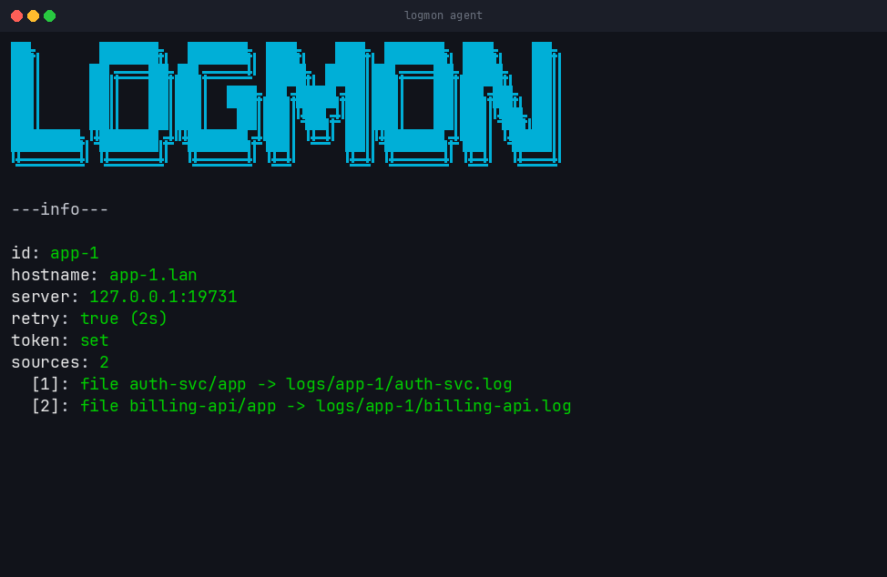

# Configuration

Three layers, and the order matters: **YAML, then environment, then flags.**

Every file is strict-parsed. An unknown key is an error at startup, not
something silently ignored — a mistyped key that does nothing is the failure
that costs an afternoon.

## Precedence

```text
1. defaults, from the code
2. the YAML file, if --config is given
3. LOGMON_AGENT_TOKEN, if the YAML omits token        (agent only)
4. command-line flags, but only ones you actually typed
```

Point 4 is the one that surprises people. A flag overrides the file **only when
explicitly set**, not when it merely has a value. Passing `--server` alone
does not blank out an address that was in the file; passing `--server ""` does.

Server YAML is effectively required — without an allowlist there is nothing for
an agent to be, and validation fails with `at least one allowed agent is
required`.

## Generating a token

```bash
TOKEN="$(openssl rand -hex 32)"
printf '%s' "$TOKEN" | sha256sum
```

**Use `printf`, not `echo`.** `echo` appends a newline and produces a different
digest. That single character is the most common setup failure, and it presents
as `authentication failed` with no other clue.

The server stores only the digest. The agent sends the original token.

## Keeping the token out of YAML

```bash
export LOGMON_AGENT_TOKEN='the-original-token'
```

The environment variable is read **only when YAML omits `token:`**. If both are
present the file wins, so a leftover token in YAML silently overrides the one
you exported — remove it from the file rather than relying on precedence.

## Path resolution

A relative path in YAML resolves against **the directory containing the config
file**, not the working directory.

```text
agent --config /etc/logmon/agent.yaml     with  path: logs/app.log
  reads  /etc/logmon/logs/app.log
```

This applies to `data_dir` on the server side too. A config and the files it
names are meant to travel together, so moving the config moves what it points
at.

Paths given on the command line resolve against the working directory, because
there is no config file for them to be relative to.

## server.yaml

```yaml
listen: 127.0.0.1:9000        # TCP bind address for agents
data_dir: data               # storage root; relative to THIS file's directory
max_connections: 100         # simultaneous agent connections
agents:                      # required, at least one
  prod-1:
    token_sha256: "<64-char sha256 hex>"
```

Every key is covered in
[../reference/configuration-reference.md](../reference/configuration-reference.md).

### Binding

`listen` defaults to `127.0.0.1`, which is loopback and therefore unreachable by
any agent but the server itself. To accept remote agents you must bind a
routable address.

Transport is plaintext and the token crosses the wire in cleartext during the
handshake. Bind to a VPN or private interface address rather than `0.0.0.0`,
and firewall the port to the agent hosts you actually run. See
[SECURITY.md](../../SECURITY.md).

## agent.yaml

```yaml
id: prod-1                   # must be in the server allowlist
hostname: api-01             # required; NO os.Hostname() fallback
server: 127.0.0.1:9000
token: "<original token>"    # or omit and use LOGMON_AGENT_TOKEN
retry: true
retry_delay: 2s
sources:                     # required, at least one
  - type: file
    path: ./app.log
    app: billing
    category: access
    from_beginning: true
```

`hostname` has no fallback and must be set explicitly. It is stored with every
record, so it is worth setting to the name you use for that host elsewhere
rather than a default.

The token must be at least **32 characters**.

### Sources

| Field | Applies to | Meaning |
|---|---|---|
| `type` | all | `file`, `journald` or `docker` |
| `path` | `file` | path to tail |
| `unit` | `journald` | systemd unit |
| `container` | `docker` | container name |
| `app` | all | required; also the storage directory name |
| `category` | all | required, 1–128 characters |
| `from_beginning` | all | `false` follows only new lines |

`app` and `category` accept letters, numbers, `.`, `_` and `-`. Agent IDs
accept the same set, up to 128 characters.

An agent declares its apps in the handshake, and the server **rejects any record
naming an app the agent did not declare**. An agent cannot write into an app
directory it never claimed.

### from_beginning

```text
true    read the file from the start, shipping everything already in it
false   seek to the end, follow only new lines
```

`false` also maps to `journalctl --lines=0` and `docker logs --tail=0`.

It is per source, so an agent can ship an existing file in full while following a
container from now on. For a file that is rotated, the tailer notices the inode
or size change and restarts from the beginning of the new file.

### Journald and Docker need privileges

Both shell out to the host CLIs.

- **journald** needs membership of the right group — `systemd-journal` on most
  distributions, `adm` on Debian-family ones. The name varies.
- **Docker** needs access to the docker group or socket, which is effectively
  root.

Neither is exercised by the test suite.

## Starting an agent

```bash
agent --config agent.yaml
```



Before collecting, the agent draws its resolved configuration: ID, hostname,
server, retry settings, token status, and each source. Fields that are wrong
print in red, so a misconfigured agent tells you which one before exiting.

`NO_COLOR`, or a stdout that is not a terminal, turns this into a static
uncoloured banner.

### Adding sources from the command line

```bash
agent --config agent.yaml \
  --file /var/log/app.log,app,access,false \
  --journal nginx.service,nginx,service,false \
  --docker billing-api,billing,container,false
```

Each source is CSV: `path,app,category,from_beginning` — with the first field
being the unit or container for the other two types.

**These replace the YAML `sources:` list entirely.** Using `--config` together
with any source flag means the file's sources are ignored, not merged. That is
usually what you want in a systemd unit, and occasionally a surprise.

## Flags over files

Server flags that override YAML: `--listen`, `--data-dir`, `--max-connections`.

`--no-tui` has no YAML equivalent, and `--gui-config` defaults to
`~/.config/logmon/config.yml`; pass an empty string to disable appearance
configuration entirely.

See [../reference/cli.md](../reference/cli.md) for every flag on both binaries.

## Appearance

`~/.config/logmon/config.yml`, or wherever `--gui-config` points. Optional, and
a partial file is valid.

```yaml
gui:
  border: rounded
  sidePanelWidth: 0.33
  graph: true
  wrap: false
  mouse: false
  theme:
    borderActive: "10"
    selectedBg: "236"
    selectedFg: "255"
```

Full key list and the colour rules are in
[../reference/configuration-reference.md](../reference/configuration-reference.md),
and the interface behaviour they control is in [viewing-logs.md](viewing-logs.md).

## A pair that runs

```bash
# server
cat > server.yaml <<'EOF'
listen: 127.0.0.1:9000
data_dir: data
max_connections: 100
agents:
  demo:
    token_sha256: "REPLACE_WITH_THE_DIGEST"
EOF

# agent
export LOGMON_AGENT_TOKEN='a-token-of-at-least-32-characters-long'
cat > agent.yaml <<'EOF'
id: demo
hostname: demo-01
server: 127.0.0.1:9000
retry: true
sources:
  - type: file
    path: /var/log/syslog
    app: syslog
    category: system
    from_beginning: false
EOF

server --config server.yaml      # terminal 1
agent --config agent.yaml        # terminal 2
```

The agent follows the file as it grows. Watch records arrive in the server's
log panel, and watch the ingest graph move.
